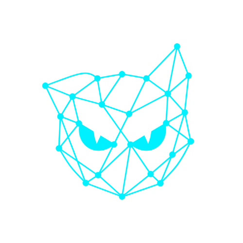

<div align="center" dir="rtl" lang="fa">
  
  <h1>سای‌مش · CyMesh</h1>
  <p><strong>پیام‌رسان رمزگذاری‌شدهٔ همتابه‌همتا برای ویندوز</strong></p>
  <p>پروژهٔ متن‌باز <strong>تیم امنیتی ساینت (Cynet)</strong></p>
  <p>
    <a href="README.md">English</a> ·
    <a href="https://github.com/Cynetx/CyMesh/actions/workflows/release-windows.yml">بیلد ویندوز</a> ·
    <a href="CONTRIBUTING.md#فارسی">مشارکت</a>
  </p>
  <p>
    <a href="https://github.com/Cynetx/CyMesh/actions/workflows/release-windows.yml"></a>
    <a href="LICENSE"></a>
  </p>
</div>

<div dir="rtl" lang="fa">

هویت‌تان را روی دستگاه بسازید، لینک دعوت را برای دوستتان بفرستید و گفتگو را شروع کنید. سای‌مش می‌تواند همتاها را روی شبکهٔ محلی پیدا کند. اگر مخاطب‌تان روی شبکهٔ دیگری است، می‌توانید از پلی که خودتان انتخاب می‌کنید استفاده کنید. ساخت حساب به شماره تلفن یا ایمیل نیاز ندارد.

## با یک دوست امتحان کنید

1. **برنامهٔ ویندوز را بگیرید.** یکی از [بیلدهای موفق ویندوز](https://github.com/Cynetx/CyMesh/actions/workflows/release-windows.yml) را باز کنید و در بخش **Artifacts** دنبال **Cymesh-Windows-x64** بگردید. برای دریافت خروجی باید وارد گیت‌هاب شوید. اگر خروجی در دسترس نبود، [برنامه را از روی سورس بسازید](#ساخت-از-روی-سورس).
2. **هویت بسازید.** برای قفل صندوق محلی یک رمز انتخاب کنید و ۱۲ کلمهٔ بازیابی را خصوصی نگه دارید. این عبارت هویت شما را برمی‌گرداند. تاریخچهٔ چت در صندوق محلی می‌ماند.
3. **دعوت را ردوبدل کنید.** اگر روی یک شبکهٔ محلی هستید، اجازهٔ کشف همتا را بدهید. گزینهٔ یافتن کاربر را باز کنید و لینک یا کد QR دعوت را به اشتراک بگذارید. از طریق همتاهای در دسترس می‌توانید شناسهٔ `@handle#TAG` را هم جست‌وجو کنید. برای تأیید هویت مخاطب، کد امنیتی را از راهی که از قبل به آن اعتماد دارید با هم مقایسه کنید.

**روی دو شبکهٔ متفاوت هستید؟** در تنظیمات، بخش **تنظیمات پیشرفته شبکه** را باز کنید. با **افزودن پل** آدرس یک پل مورد اعتماد را وارد کنید یا بستهٔ `CYMESH-SEED` را همان‌جا وارد کنید. نسخهٔ عمومی با فهرست پل خالی شروع می‌شود. تحویل پیام به در دسترس بودن همتا یا رله بستگی دارد.

## با سای‌مش چه کارهایی می‌شود کرد؟

| قابلیت | چه کمکی می‌کند؟ |
| --- | --- |
| **گفتگو به فارسی و انگلیسی** | بین چیدمان راست‌به‌چپ و چپ‌به‌راست جابه‌جا شوید. به پیام پاسخ بدهید، واکنش بگذارید، آن را ویرایش کنید یا زمان انقضا تعیین کنید. |
| **اتصال مستقیم یا از طریق رله** | همتاها را روی شبکهٔ محلی یا از راه فهرست توزیع‌شده پیدا کنید. یک رلهٔ در دسترس می‌تواند بستهٔ رمزگذاری‌شده را برای تحویل بعدی نگه دارد. |
| **نگهداری هویت و گفتگو روی دستگاه** | صندوق رمزگذاری‌شده را با رمز محلی باز کنید. برای برگرداندن هویت در یک نصب تازه از عبارت بازیابی استفاده کنید. |
| **دیدن وضعیت اتصال** | مسیر اتصال، همتاهای شبکهٔ مش و صف بسته‌ها را در برنامه ببینید. می‌توانید اتصال به رله‌ای که خودتان وارد می‌کنید را هم بررسی کنید. |

## ساخت از روی سورس

[Rust پایدار](https://rustup.rs/)، [Node.js 24 همراه npm](https://nodejs.org/) و [پیش‌نیازهای Tauri](https://v2.tauri.app/start/prerequisites/) را نصب کنید. در ویندوز، **Visual Studio C++ Build Tools** با گزینهٔ **Desktop development with C++** و **WebView2 Runtime** لازم‌اند.

پروژه را از ترمینال بگیرید و اجرا کنید.

<div dir="ltr" align="left">

```sh
git clone https://github.com/Cynetx/CyMesh.git
cd CyMesh
npm ci
npm --prefix ui ci
npm run dev
```

</div>

تست‌های Rust و بیلد رابط را اجرا کنید.

<div dir="ltr" align="left">

```sh
cargo test --locked -p aegis-core
npm --prefix ui run build
```

</div>

برای ساخت برنامهٔ ویندوز x64 و نصب‌کنندهٔ NSIS، روی ویندوز این دستور را اجرا کنید.

<div dir="ltr" align="left">

```sh
npm run build -- --bundles nsis -- --locked
```

</div>

فایل اجرایی در `target/release/Cymesh.exe` و نصب‌کننده در `target/release/bundle/nsis/` قرار می‌گیرد.

<details>
<summary>ساخت بستهٔ قابل‌حمل ویندوز از لینوکس</summary>

روی لینوکس MinGW-w64، ابزار `zip`، Rust و Node.js همراه npm را نصب کنید. بعد دستورهای زیر را اجرا کنید.

<div dir="ltr" align="left">

```sh
rustup target add x86_64-pc-windows-gnu
./scripts/build-windows.sh
```

</div>

اسکریپت بسته را در `dist-windows/Cymesh-Windows-x64-Portable.zip` می‌سازد. برای اجرای نسخهٔ قابل‌حمل، ویندوز به WebView2 Runtime نیاز دارد.

</details>

## رلهٔ خودتان را راه بیندازید

رله می‌تواند یک نقطهٔ اتصال در دسترس برای اعضای گروه‌تان باشد که روی شبکه‌های مختلف‌اند. در لینوکس، از ریشهٔ پروژه این دستورها را با Bash اجرا کنید.

<div dir="ltr" align="left">

```bash
cargo build --locked --release -p aegis-core --bin cymesh-relay
read -r -s -p 'Relay vault passphrase: ' relay_pin
printf '\n'
CYMESH_RELAY_PIN="$relay_pin" ./target/release/cymesh-relay --port 47833
unset relay_pin
```

</div>

رله را با یک حساب سیستمی مستقل و بدون دسترسی مدیریتی اجرا کنید و رمز صندوقش را برای اجراهای بعدی نگه دارید. در برنامه، آی‌پی و پورت در دسترس رله را از مسیر **افزودن پل** وارد کنید. پورت پیش‌فرض شبکهٔ مش **۴۷۸۳۳ روی TCP و UDP** است. کشف همتا در شبکهٔ محلی به‌طور پیش‌فرض از **پورت UDP ۴۷۸۳۲** استفاده می‌کند. برای تنظیم پوشهٔ داده و پل‌های ورودی، خروجی `cymesh-relay --help` را ببینید.

## معماری و حریم خصوصی

| بخش | مسئولیت |
| --- | --- |
| [رابط React](ui/src/) | چت، افزودن مخاطب، تنظیمات و ترجمهٔ فارسی و انگلیسی |
| [برنامهٔ دسکتاپ Tauri](src-tauri/) | یکپارچگی با ویندوز و ارتباط رابط با هستهٔ Rust |
| [هستهٔ Rust](crates/aegis-core/) | هویت، ذخیره‌سازی رمزگذاری‌شده، کشف همتا، ارتباط و Relay |

سای‌مش از پروفایل‌های امضاشده، کانال Noise، رمزنگاری پیام با Double Ratchet و مسیریابی پیازی اختیاری استفاده می‌کند. همتا و رله می‌توانند اطلاعات اتصال مثل آی‌پی را ببینند. رله و صف آفلاین می‌توانند برای دسترسی موقتاً قطع‌شده کمک کنند. اگر در قطعی شبکه مسیری به مخاطب وجود نداشته باشد، تحویل پیام ممکن است تا وصل شدن دوباره منتظر بماند. تست‌های خودکار پروژه سناریوهای چندهمتایی را روی شبکهٔ محلی بررسی می‌کنند.

برنامه آداپتور شبکه و تنظیمات پروکسی را روی دستگاه بررسی می‌کند. بررسی کشور آی‌پی به‌صورت پیش‌فرض خاموش است. با فعال کردن آن، سرویس‌های HTTPS بیرونی آی‌پی اتصال را برای تشخیص کشور دریافت می‌کنند. لینک‌های دعوت و بسته‌های Seed ممکن است حاوی آدرس شبکه باشند. آن‌ها را فقط برای مخاطبان مورد نظر بفرستید.

## در ساخت سای‌مش همراه شوید

گفتگو را بین دو دستگاه امتحان کنید، تجربه‌تان را به ما بگویید یا در بهتر شدن رابط فارسی و انگلیسی کمک کنید. [ثبت گزارش](https://github.com/Cynetx/CyMesh/issues) · [راهنمای مشارکت](CONTRIBUTING.md#فارسی) · [گزارش خصوصی مشکل امنیتی](SECURITY.md#فارسی)

**جامعهٔ ساینت** · [سایت](https://cynetx.ir/) · [انجمن](https://forum.cynetx.ir/) · [کانال تلگرام](https://t.me/cynetx) · [گروه تلگرام](https://t.me/cynetgap) · [گیت‌هاب](https://github.com/Cynetx)

سای‌مش با [مجوز MIT](LICENSE) در دسترس است.

</div>
