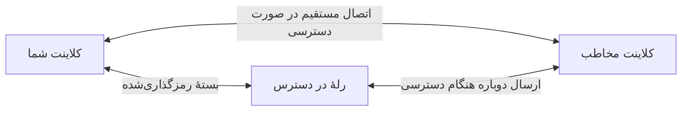

<div align="center" dir="rtl" lang="fa">
  
  <h1>سای‌مش | CyMesh</h1>
  <p><strong>پیام‌رسان متن‌باز و رمزگذاری‌شدهٔ همتابه‌همتا برای ویندوز</strong></p>
  <p>ساختهٔ <strong>تیم امنیتی ساینت</strong> · فارسی و انگلیسی</p>
  <p>
    <a href="README.md"><strong>English</strong></a> ·
    <a href="#first-chat">اولین گفتگو</a> ·
    <a href="#relay-builder">ساخت نسخهٔ سفارشی</a> ·
    <a href="#grow-the-mesh">مشارکت از داخل برنامه</a>
  </p>
  <a href="https://github.com/Cynetx/CyMesh/actions/workflows/release-windows.yml"></a>
  <a href="LICENSE"></a>
</div>

<div dir="rtl" lang="fa">

سای‌مش را روی دو کامپیوتر در یک شبکهٔ محلی باز کنید. روی هرکدام یک هویت بسازید، لینک دعوت را ردوبدل کنید و اولین پیام را بفرستید. برای شروع شماره تلفن یا ایمیل لازم نیست. اگر روی دو شبکهٔ متفاوت هستید، می‌توانید از یک پل مورد اعتماد استفاده کنید یا رلهٔ خودتان را راه بیندازید.

<a name="first-chat"></a>

## اولین گفتگو را راه بیندازید

1. **برنامه را روی هر دو کامپیوتر بگیرید.** به گیت‌هاب وارد شوید، یک [بیلد موفق ویندوز](https://github.com/Cynetx/CyMesh/actions/workflows/release-windows.yml) را باز کنید و در بخش **Artifacts** دنبال **Cymesh-Windows-x64** بگردید. اگر خروجی در دسترس نبود، از [راهنمای ساخت از سورس](#build-from-source) استفاده کنید.
2. **هویت بسازید و رمز بگذارید.** ۱۲ کلمهٔ بازیابی را خصوصی نگه دارید. این کلمات برای برگرداندن هویت‌اند. تاریخچهٔ گفتگو در صندوق رمزگذاری‌شدهٔ دستگاه می‌ماند.
3. **بخش یافتن کاربر را باز کنید.** لینک دعوت یا کد QR را با مخاطب به اشتراک بگذارید. از طریق همتاهای در دسترس می‌توانید شناسهٔ `@handle#TAG` را هم پیدا کنید.
4. **هویت مخاطب را تأیید کنید.** در پروفایل، کد امنیتی یا شش ایموجی را از راهی که از قبل به آن اعتماد دارید مقایسه کنید. اگر یکسان بودند، مخاطب را تأیید کنید.

اگر دو کامپیوتر روی دو شبکه‌اند، در **تنظیمات** بخش **تنظیمات پیشرفته شبکه** را باز کنید و از **افزودن پل** آدرس یک پل مورد اعتماد را وارد کنید. همان‌جا می‌توانید بستهٔ `CYMESH-SEED` را هم وارد کنید. نسخهٔ عمومی با فهرست پل خالی شروع می‌شود.

## قابلیت‌های سای‌مش

| بخش برنامه | امکانات |
| --- | --- |
| **گفتگو** | پیام متنی رمزگذاری‌شده بفرستید، به پیام مشخصی پاسخ دهید، واکنش ایموجی بگذارید، پیام را ویرایش کنید، از دستگاه خودتان حذف کنید یا درخواست حذف برای هر دو طرف بدهید و برای پیام زمان انقضا بگذارید. |
| **وضعیت پیام و گفتگو** | ببینید پیام در صف است، مستقیم فرستاده شده، از رله عبور کرده، تحویل شده یا خوانده شده است. نشانگر تایپ را ببینید، گفتگو را سنجاق کنید و فهرست چت‌ها را براساس مسیر یا مخاطب تأییدشده فیلتر کنید. |
| **هویت و دعوت** | روی دستگاه هویت بسازید، پروفایل را شخصی‌سازی کنید و با شناسه، لینک، QR یا آدرس شناخته‌شدهٔ همتا وصل شوید. حالت روح نام کاربری را از جست‌وجوی حساب پنهان می‌کند. |
| **حریم خصوصی روی دستگاه** | صندوق رمزگذاری‌شده را با رمز باز کنید و با `Ctrl+L` قفل کنید. هویت‌تان را با ۱۲ کلمه برگردانید یا رمز اضطراری اختیاری تنظیم کنید. |
| **کشف همتا و مسیریابی** | مخاطب را در شبکهٔ محلی یا از طریق فهرست توزیع‌شده پیدا کنید. سای‌مش می‌تواند برای اتصال مستقیم تلاش کند یا بستهٔ رمزگذاری‌شده را با کمک رلهٔ در دسترس نگه دارد و تحویل دهد. مسیریابی پیازی چندمرحله‌ای اختیاری است. |
| **عیب‌یابی و تنظیم شبکه** | مسیر اتصال، همتاهای شناخته‌شده، صف پیام و فعالیت رله را ببینید. از تنظیمات، اتصال به رله را آزمایش کنید و بستهٔ `CYMESH-SEED` بگیرید یا وارد کنید. |
| **رابط دوزبانهٔ دسکتاپ** | بین فارسی راست‌به‌چپ و انگلیسی چپ‌به‌راست جابه‌جا شوید. در نسخهٔ قابل‌حمل ویندوز می‌توانید میان‌بر دسکتاپ و منوی Start بسازید. |

## دو مسیر برای مشارکت با رله

| می‌خواهم… | از کجا شروع کنم؟ | نتیجه |
| --- | --- | --- |
| نسخهٔ سفارشی ویندوز را برای اعضای گروه خودم بسازم | [بیلدر مستقل از سورس](#relay-builder) | یک کلاینت جداگانه که از ابتدا آدرس رلهٔ من را دارد |
| به گسترش شبکه‌ای کمک کنم که با کلاینت فعلی از آن استفاده می‌کنم | [مشارکت از تنظیمات](#grow-the-mesh) | رلهٔ فعالم ثبت می‌شود و کلاینت اطلاعات آن را با همتاهای متصل به اشتراک می‌گذارد |

<a name="relay-builder"></a>

### برای برنامه‌نویس‌ها · ساخت نسخهٔ سفارشی برای گروه خودتان

اگر رلهٔ خودتان را اداره می‌کنید و می‌خواهید اعضای گروه پس از نصب مستقیم از همان پل استفاده کنند، از بیلدر استفاده کنید.

۱. سورس را بگیرید و [پیش‌نیازهای ساخت](#build-from-source) را نصب کنید. از ریشهٔ پروژه اجرا کنید.

<div dir="ltr" align="left">

```sh
npm run relay-builder
```

</div>

۲. **IPv4 قابل دسترس** و **پورت TCP/UDP رله** را وارد کنید. پورت پیش‌فرض `47833` است. دستورهایی که ابزار چاپ می‌کند را روی سرور لینوکسی اجرا کنید. رمز صندوق رله را هنگام راه‌اندازی روی همان سرور وارد کنید.

۳. روی دستگاه بیلد، دستور چاپ‌شده با شناسهٔ پروفایل خودتان را اجرا کنید.

<div dir="ltr" align="left">

```sh
npm run relay-builder -- build <profile-id>
```

</div>

۴. خروجی را از `.cymesh-builder/<profile-id>/windows/` بردارید. روی **ویندوز** نصب‌کنندهٔ **NSIS برای x64** ساخته می‌شود. روی **لینوکس** با MinGW-w64 و ابزار `zip`، خروجی **ZIP قابل‌حمل ویندوز x64** است. پس از استخراج ZIP، فایل `Cymesh.exe` را اجرا کنید.

در این نسخه، رلهٔ شما هنگام ساخت یا بازیابی هویت به فهرست پل‌های اولیه می‌رود. کاربر می‌تواند آن را از تنظیمات حذف کند. هر پروفایل صندوق و میان‌برهای خودش را دارد. آدرس رله از فایل اجرایی قابل خواندن است. بیلد را با مخاطب‌های موردنظر به اشتراک بگذارید و دسترسی به رله را در سطح شبکه کنترل کنید.

<a name="grow-the-mesh"></a>

### برای داوطلب‌ها · گسترش شبکه از داخل برنامه

این مسیر برای افزودن رلهٔ داوطلبانه به شبکه‌ای است که با کلاینت فعلی از آن استفاده می‌کنید. همهٔ مراحل ثبت و معرفی رله از همان برنامه قابل انجام است.

1. صندوق را باز کنید و به **تنظیمات → همکاری در گسترش شبکه (نود داوطلب)** بروید.
2. اگر هنوز رله را راه نینداخته‌اید، **کپی دستور راه‌اندازی سرور** را بزنید و دستور را در پوشهٔ سورس CyMesh روی میزبان لینوکسی اجرا کنید. اگر رله روشن است، `IP:Port` در دسترس آن را آماده کنید.
3. آدرس را در بخش داوطلب وارد کنید و **تست، اتصال و معرفی به شبکه** را بزنید. کلاینت هندشیک Noise را آزمایش می‌کند، آدرس را به‌عنوان پل ذخیره می‌کند و اطلاعات تماس رله را با همتاهایی که همان لحظه به کلاینت وصل‌اند به اشتراک می‌گذارد.
4. از **بررسی اتصال به رله** برای دیدن وضعیت هندشیک و تأخیر استفاده کنید. مسیرها، همتاها و فعالیت رله را هم در بخش **وضعیت زنده شبکه مش** می‌بینید.

در بخش **حریم خصوصی و موتور مش** گزینهٔ **رله کور مش (Store-and-Forward)** هم هست. با فعال بودن آن، کلاینتی که صندوقش باز است و از شبکه در دسترس است می‌تواند به جابه‌جایی بسته‌های رمزگذاری‌شده کمک کند. برای اینکه فقط کلاینت خودتان از یک ورودی شبکه استفاده کند، سراغ **افزودن پل** بروید.

<details>
<summary><strong>اگر اتصال یا تحویل پیام گیر کرد</strong></summary>

- **در شبکهٔ محلی**، صندوق هر دو دستگاه باید باز باشد. بررسی کنید دستگاه‌ها به هم دسترسی دارند. بعضی شبکه‌های وای‌فای مهمان دستگاه‌ها را از هم جدا می‌کنند.
- **با رله**، آدرس را از شبکهٔ کلاینت با **بررسی اتصال به رله** آزمایش کنید. گاهی رله روی شبکهٔ خودش روشن است اما از بیرون به آن دسترسی نیست.
- **در گفتگو**، «در صف» یعنی پیام منتظر مسیر است. «تحویل‌شده» و «خوانده‌شده» دو رسید جداگانه‌اند. ممکن است مخاطب پس از درخواست حذف یا انقضا همچنان نسخه‌ای از پیام را نگه داشته باشد.

</details>

## مسیر یک پیام

<div dir="ltr" align="left">



</div>

سای‌مش از پروفایل امضاشده، کانال Noise، رمزگذاری پیام با Double Ratchet و صندوق محلی رمزگذاری‌شده استفاده می‌کند. مسیریابی، NAT و فایروال روی دسترسی اثر می‌گذارند. اگر مسیر مستقیمی به مخاطب یا مسیری از طریق رله وجود نداشته باشد، ممکن است پیام در صف بماند.

<details>
<summary><strong>چه اطلاعاتی در شبکه دیده می‌شود؟</strong></summary>

همتاها و رله‌ها می‌توانند اطلاعات اتصال، مثل آی‌پی، را ببینند. لینک دعوت و بستهٔ پل ممکن است آدرس شبکه داشته باشند. برنامه آداپتورهای محلی و تنظیمات پروکسی را بررسی می‌کند. بررسی اختیاری کشور آی‌پی به‌طور پیش‌فرض خاموش است و با فعال شدن، آی‌پی اتصال به سرویس‌های HTTPS بیرونی می‌رسد. تست‌های خودکار پروژه سناریوهای محلی چندهمتایی را بررسی می‌کنند.

</details>

<a name="build-from-source"></a>

## ساخت از سورس

[Rust پایدار](https://rustup.rs/)، [Node.js نسخهٔ ۲۴ همراه npm](https://nodejs.org/) و [پیش‌نیازهای Tauri](https://v2.tauri.app/start/prerequisites/) را نصب کنید. روی ویندوز به ابزارهای Visual Studio با گزینهٔ **Desktop development with C++** و **WebView2 Runtime** نیاز دارید.

<div dir="ltr" align="left">

```sh
git clone https://github.com/Cynetx/CyMesh.git
cd CyMesh
npm ci
npm --prefix ui ci
npm run dev
```

</div>

<details>
<summary><strong>تست، بیلد انتشار و اجرای رله</strong></summary>

تست هسته و ساخت رابط را از ریشهٔ مخزن اجرا کنید.

<div dir="ltr" align="left">

```sh
cargo test --locked -p aegis-core
npm --prefix ui run build
```

</div>

روی ویندوز x64، نسخهٔ عمومی و نصب‌کنندهٔ NSIS را بسازید.

<div dir="ltr" align="left">

```sh
npm run build -- --bundles nsis -- --locked
```

</div>

فایل اجرایی در `target/release/Cymesh.exe` و نصب‌کننده در `target/release/bundle/nsis/` است.

برای ساخت نسخهٔ عمومی قابل‌حمل روی لینوکس، MinGW-w64 و `zip` را نصب کنید. برای اجرای خروجی، ویندوز به WebView2 نیاز دارد.

<div dir="ltr" align="left">

```sh
rustup target add x86_64-pc-windows-gnu
./scripts/build-windows.sh
```

</div>

خروجی در `dist-windows/Cymesh-Windows-x64-Portable.zip` قرار می‌گیرد.

برای اجرای رله روی لینوکس، با Bash و یک حساب سیستمی بدون دسترسی مدیریتی مراحل زیر را انجام دهید. رمز صندوق را برای راه‌اندازی‌های بعدی نگه دارید.

<div dir="ltr" align="left">

```bash
cargo build --locked --release -p aegis-core --bin cymesh-relay
read -r -s -p 'Relay vault passphrase: ' relay_pin
printf '\n'
CYMESH_RELAY_PIN="$relay_pin" ./target/release/cymesh-relay --port 47833
unset relay_pin
```

</div>

پورت پیش‌فرض مش `47833` روی TCP و UDP است. کشف محلی از UDP روی `47832` استفاده می‌کند. برای انتخاب مسیر داده و تنظیم پل‌های ورودی، `cymesh-relay --help` را ببینید.

</details>

| دنبال کدام بخش می‌گردید؟ | مسیر کد |
| --- | --- |
| گفتگو، دعوت، ترجمه‌ها و تنظیم شبکه | [رابط React](ui/src/) |
| یکپارچگی دسکتاپ و فرمان‌هایی که رابط صدا می‌زند | [برنامهٔ Tauri](src-tauri/) |
| هویت، صندوق، تحویل، کشف و اجرای رله | [هستهٔ Rust](crates/aegis-core/) |
| راه‌اندازی تعاملی و بیلد ویندوز براساس پروفایل | [بیلدر رله](scripts/relay-builder.mjs) |

## در ساخت سای‌مش همراه شوید

روی دو دستگاه گفتگو را امتحان کنید و بگویید کدام بخش روان بود یا کجا گیر کردید. برای کمک به کد و ترجمه به [راهنمای مشارکت](CONTRIBUTING.md#فارسی) سر بزنید. برای باگی که می‌توانید دوباره ایجاد کنید [گزارش ثبت کنید](https://github.com/Cynetx/CyMesh/issues) و مشکل امنیتی را از [مسیر خصوصی](SECURITY.md#فارسی) بفرستید.

**تیم امنیتی ساینت** · [سایت](https://cynetx.ir/) · [انجمن](https://forum.cynetx.ir/) · [کانال تلگرام](https://t.me/cynetx) · [گروه تلگرام](https://t.me/cynetgap) · [گیت‌هاب](https://github.com/Cynetx)

سای‌مش با [مجوز MIT](LICENSE) منتشر شده است.

</div>
