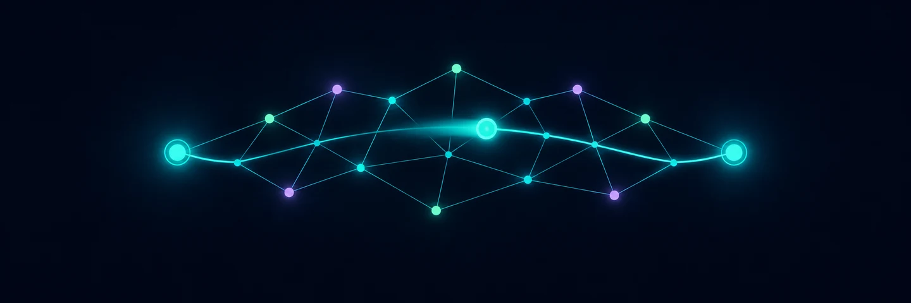
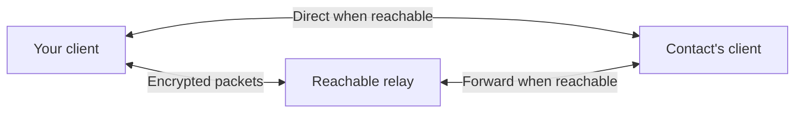

<div align="center">
  
  <h1>CyMesh</h1>
  <p><strong>An open-source, encrypted peer-to-peer messenger for Windows</strong></p>
  <p>Built by the <strong>Cynet security team</strong> · English and Persian</p>
  <p>
    <a href="README.fa.md"><strong>راهنمای فارسی</strong></a> ·
    <a href="#first-chat">First chat</a> ·
    <a href="#relay-builder">Custom build</a> ·
    <a href="#grow-the-mesh">Volunteer in the app</a>
  </p>
  <a href="https://github.com/Cynetx/CyMesh/actions/workflows/release-windows.yml"></a>
  <a href="LICENSE"></a>
</div>

Open CyMesh on two computers on the same local network. Create an identity on each, share an invite, and send a message. No phone number or email is required to start. Across networks, you can add a reachable bridge that you trust or run your own relay.

<a name="first-chat"></a>

## Your first conversation

1. **Get CyMesh onto both computers.** Sign in to GitHub, open a successful [Windows build](https://github.com/Cynetx/CyMesh/actions/workflows/release-windows.yml) and look for **Cymesh-Windows-x64** under **Artifacts**. If an artifact is unavailable, use the [source build steps](#build-from-source).
2. **Create an identity and set a PIN.** Keep your 12 recovery words private. They restore your identity. Your chat history lives in the encrypted local vault.
3. **Open Find People.** Share an invite link or its QR code with your contact. You can also search by `@handle#TAG` through peers your client can reach.
4. **Verify your contact.** In the profile drawer, compare the safety number or six emojis through a channel you already trust. Mark the contact as verified if they match.

If the two computers are on different networks, open **Settings → Advanced Network & Blackout Bridge Kit → Add Bridge** and enter a trusted bridge address. You can also import a `CYMESH-SEED` bundle from that section. The public build starts with an empty bridge list.

## What you can do in CyMesh

| In the app | Features |
| --- | --- |
| **Conversation** | Send encrypted text, reply to a specific message, react with emoji, edit messages, delete locally or request deletion on both clients, and set an expiry timer. |
| **Message and chat status** | See when a message is queued, sent directly, relayed, delivered or read. See typing indicators, pin chats and filter by route or verified contact. |
| **Identity and invitations** | Create an identity on-device, personalize your profile, and connect using an account ID, link, QR code or known peer address. Use Stealth Mode to hide your handle from account searches. |
| **Local privacy** | Unlock the encrypted vault with a PIN and lock it with `Ctrl+L`. Restore your identity with 12 words or configure an optional duress PIN. |
| **Peer discovery and routing** | Find peers on your LAN or through a distributed directory. CyMesh can try a direct connection or store and forward encrypted packets through an available relay. Multi-hop onion routing is optional. |
| **Diagnostics and controls** | Inspect the active route, known mesh contacts, queued packets and relay activity. Test a relay address from Settings and import or export `CYMESH-SEED` bundles. |
| **Bilingual desktop** | Switch between English and Persian with left-to-right and right-to-left layouts. The portable Windows app can create desktop and Start Menu shortcuts. |

## Two ways to contribute a relay

| I want to… | Use | What I get |
| --- | --- | --- |
| Ship a preconfigured Windows app to my group | [Standalone relay builder](#relay-builder) from the source checkout | A separate client build that starts with my relay as its initial bridge |
| Help peers who already use a CyMesh client | [Volunteer from Settings](#grow-the-mesh) in the installed app | My running relay is registered and announced to peers connected to that client |

<a name="relay-builder"></a>

### For developers · Build an edition for your own group

Use this path if you manage a relay and want your group’s Windows build to arrive with its address already configured.

1. Clone the repo and install the [build prerequisites](#build-from-source). In the source checkout, run:

   ```sh
   npm run relay-builder
   ```

2. Enter a reachable **IPv4 address** and the relay’s **TCP/UDP port**. The default port is `47833`. Run the commands the wizard prints on your Linux relay host. Enter the vault passphrase on that host when starting the relay.
3. Back on the build machine, run the printed build command, which includes your generated profile ID:

   ```sh
   npm run relay-builder -- build <profile-id>
   ```

4. Get the package from `.cymesh-builder/<profile-id>/windows/`. A Windows build machine produces an **x64 NSIS installer**. A Linux build machine with MinGW-w64 and `zip` produces a **portable Windows x64 ZIP**. Unpack the ZIP before launching `Cymesh.exe`.

When someone creates or restores an identity in this edition, CyMesh adds your relay as its initial bridge. The bridge can be removed later in Settings. Each profile uses its own vault and shortcuts. The address can be read from the executable. Share the build with the intended group and manage who can reach your relay at the network level.

<a name="grow-the-mesh"></a>

### For volunteers · Grow the network from the installed client

Use this path when you want to connect your relay to a mesh you already use. It runs from the existing CyMesh app.

1. Unlock the client and open **Settings → Expand Network (Contribute Volunteer Relay)**.
2. If your relay is still being set up, choose **Copy Setup Command** and run it in the CyMesh source checkout on your Linux relay host. If the relay is already running, use its reachable `IP:Port`.
3. Enter that address in the volunteer section and click **Verify & Announce to Mesh**. The client tests the Noise handshake, saves the address as a bridge and shares relay contact information with peers currently connected to that client.
4. Use **Relay connectivity** to check the handshake and latency. **Live Mesh Diagnostics** shows routes, known peers and relay activity.

The same Settings screen also has **Blind Mesh Store-and-Forward** under **Privacy & Mesh Engine**. With that setting enabled, a reachable client can help carry encrypted packets while its vault is unlocked. To simply give your own client a network entry point, use **Add Bridge**.

<details>
<summary><strong>If pairing or delivery stalls</strong></summary>

- **On a LAN**, check that both vaults are unlocked and that the network allows devices to reach one another. Some guest Wi-Fi networks isolate devices.
- **With a relay**, use **Relay connectivity** to test the address from the client’s network. A relay can be online locally and still be unreachable to someone on another network.
- **In a chat**, a message marked **Queued** is waiting for a route. **Delivered** and **Read** are separate acknowledgments. A recipient may still have a copy of a message after a delete request or expiry.

</details>

## How a message travels



CyMesh uses signed profiles, Noise transport, Double Ratchet message encryption and an encrypted local vault. Reachability depends on routing, NAT and firewall settings. If there is no route between the peers or via a relay, a message can remain queued.

<details>
<summary><strong>What is visible on the network?</strong></summary>

Peers and relays can see connection metadata, including IP addresses. Invite links and bridge bundles may include network addresses. The client checks local adapters and proxy settings. Its optional country check is off by default and sends the source IP to third-party HTTPS services when enabled. The included automated tests cover local multi-peer scenarios.

</details>

## Build from source

Install [stable Rust](https://rustup.rs/), [Node.js 24 with npm](https://nodejs.org/) and the [Tauri prerequisites](https://v2.tauri.app/start/prerequisites/). Windows needs the Visual Studio **Desktop development with C++** workload and the WebView2 Runtime.

```sh
git clone https://github.com/Cynetx/CyMesh.git
cd CyMesh
npm ci
npm --prefix ui ci
npm run dev
```

<details>
<summary><strong>Tests, release builds and the relay CLI</strong></summary>

From the repository root, run the core tests and build the frontend:

```sh
cargo test --locked -p aegis-core
npm --prefix ui run build
```

On x64 Windows, build the public edition and NSIS installer:

```sh
npm run build -- --bundles nsis -- --locked
```

The executable is `target/release/Cymesh.exe`, and the installer is under `target/release/bundle/nsis/`.

On Linux, install MinGW-w64 and `zip` to build the public portable ZIP. Windows needs WebView2 to run it.

```sh
rustup target add x86_64-pc-windows-gnu
./scripts/build-windows.sh
```

The portable ZIP is `dist-windows/Cymesh-Windows-x64-Portable.zip`.

To run the relay on Linux with Bash, use a dedicated unprivileged account and keep the vault passphrase for restarts:

```bash
cargo build --locked --release -p aegis-core --bin cymesh-relay
read -r -s -p 'Relay vault passphrase: ' relay_pin
printf '\n'
CYMESH_RELAY_PIN="$relay_pin" ./target/release/cymesh-relay --port 47833
unset relay_pin
```

The default mesh listener uses TCP/UDP `47833`. LAN discovery uses UDP `47832`. Run `cymesh-relay --help` for data directory and bootstrap options.

</details>

| Where to look | Code |
| --- | --- |
| Chat, pairing, translations and network settings | [React UI](ui/src/) |
| Desktop setup and commands exposed to the UI | [Tauri app](src-tauri/) |
| Identity, vault, delivery, discovery and the relay CLI | [Rust core](crates/aegis-core/) |
| Interactive setup and profile-specific Windows builds | [Relay builder](scripts/relay-builder.mjs) |

## Help shape the project

Try a chat between two devices and tell us where setup went smoothly or where you got stuck. If you work on code or translations, use the [contributing guide](CONTRIBUTING.md). For a reproducible bug, [open an issue](https://github.com/Cynetx/CyMesh/issues). For security bugs, follow the [private reporting guide](SECURITY.md).

**Cynet security team** · [Website](https://cynetx.ir/) · [Forum](https://forum.cynetx.ir/) · [Telegram channel](https://t.me/cynetx) · [Telegram group](https://t.me/cynetgap) · [GitHub](https://github.com/Cynetx)

CyMesh is released under the [MIT License](LICENSE).
