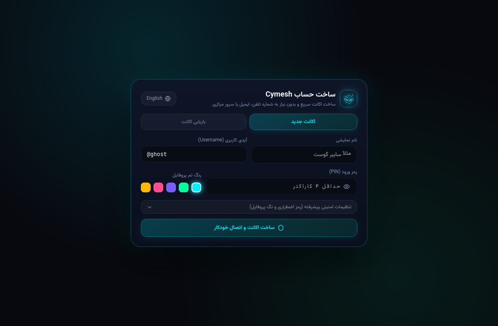
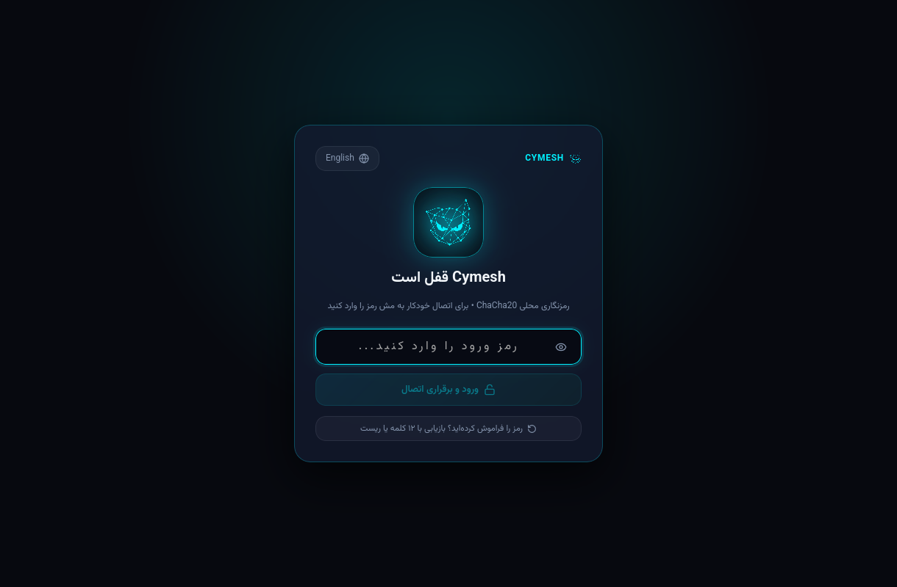
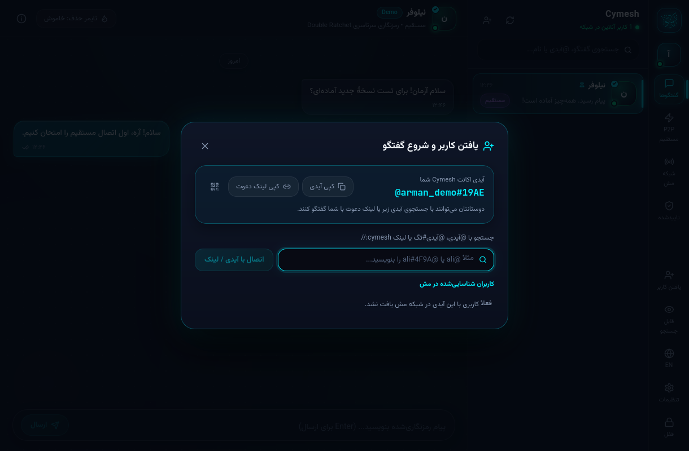
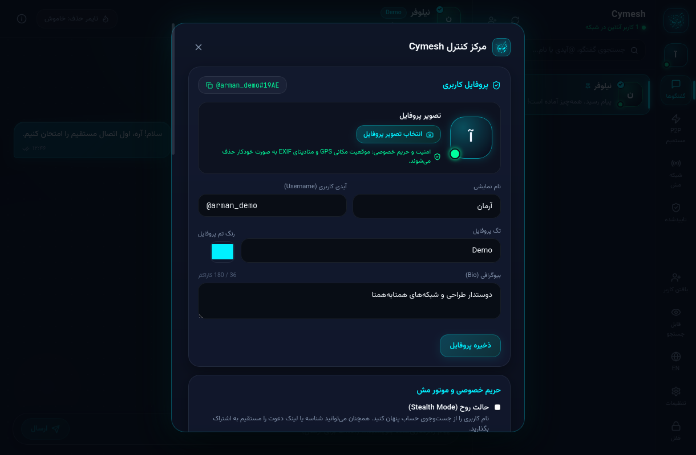
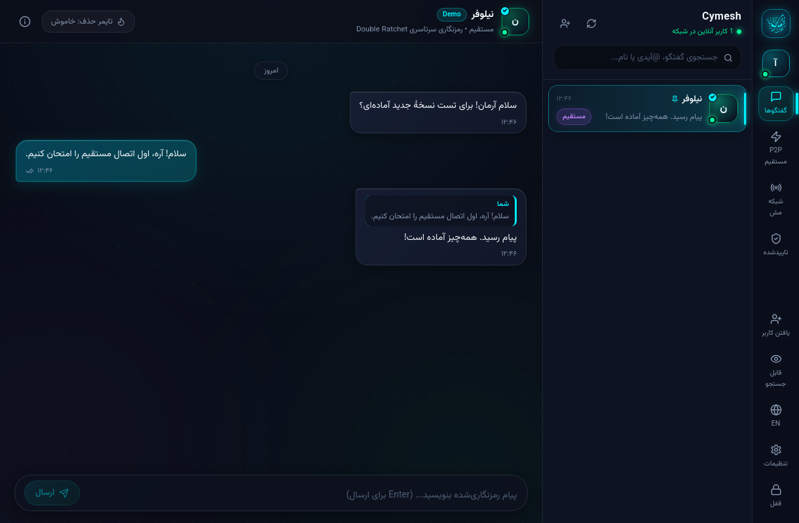
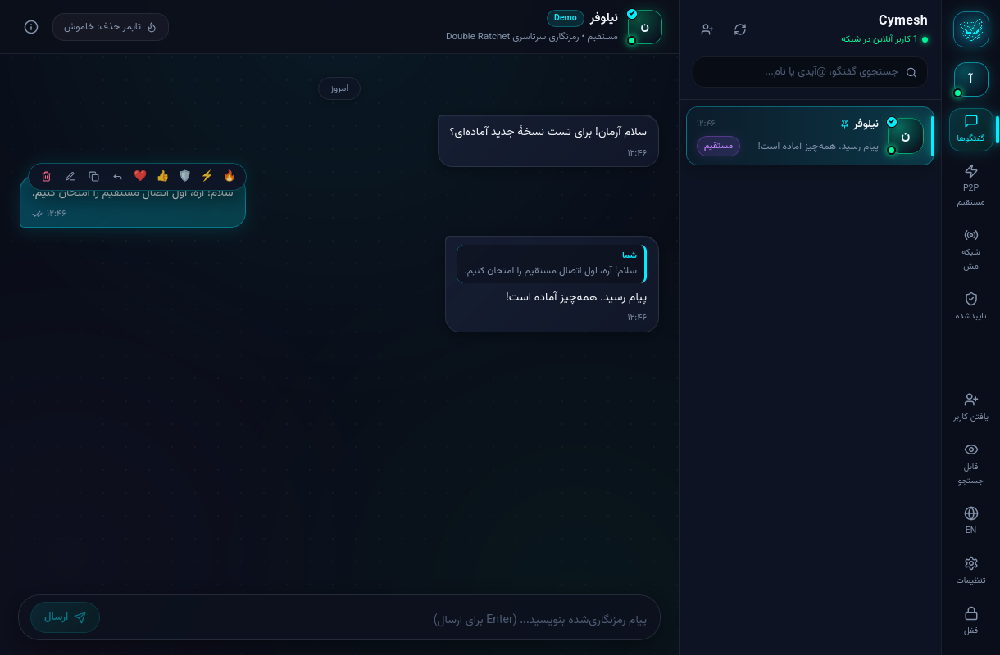
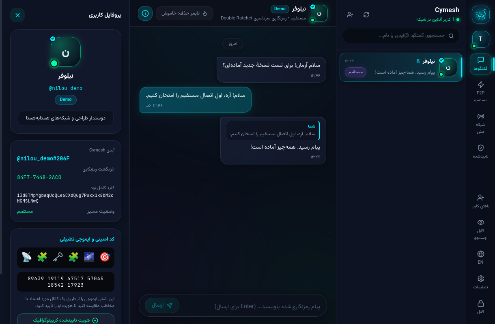
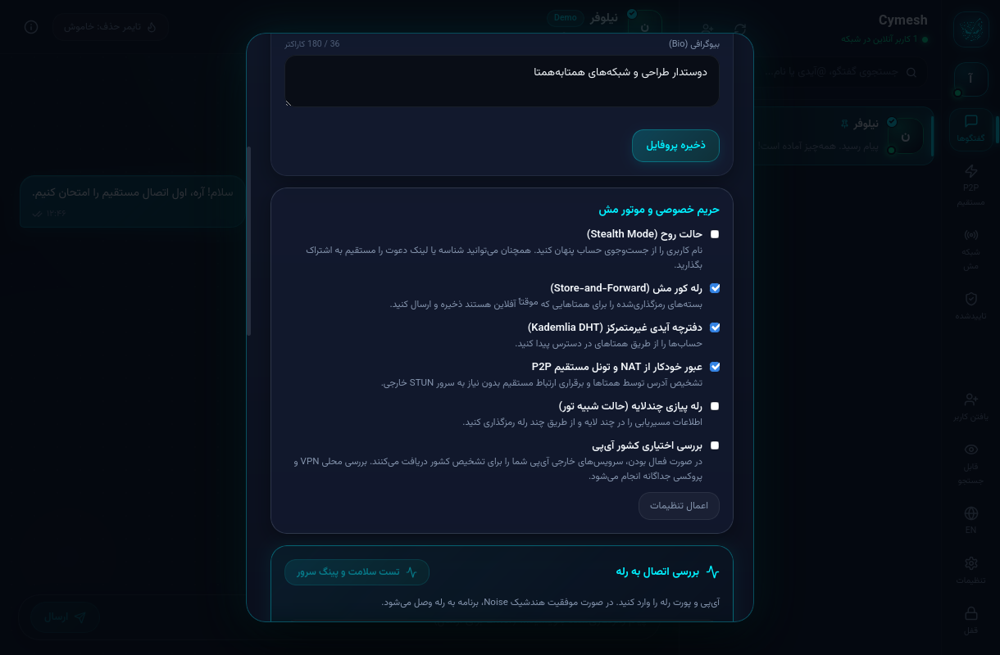
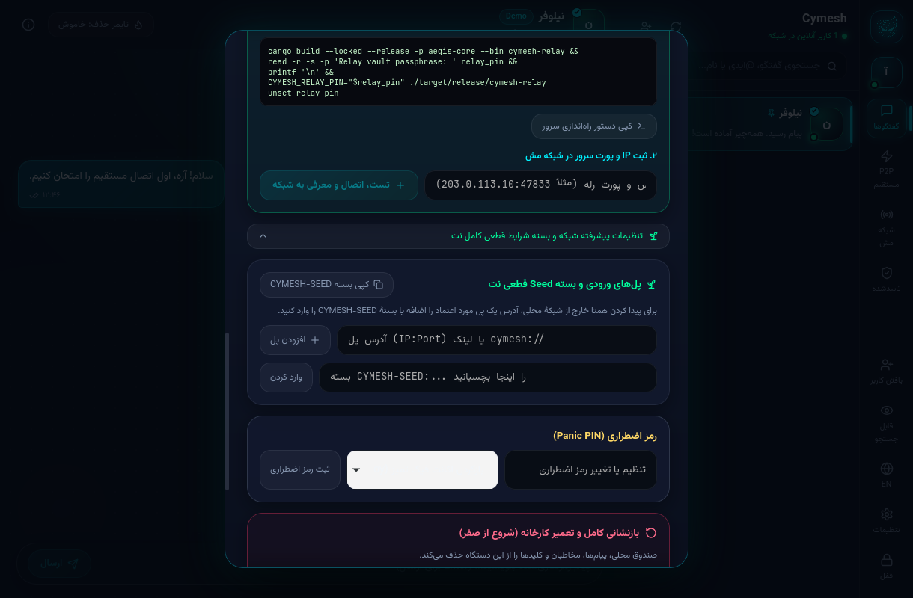
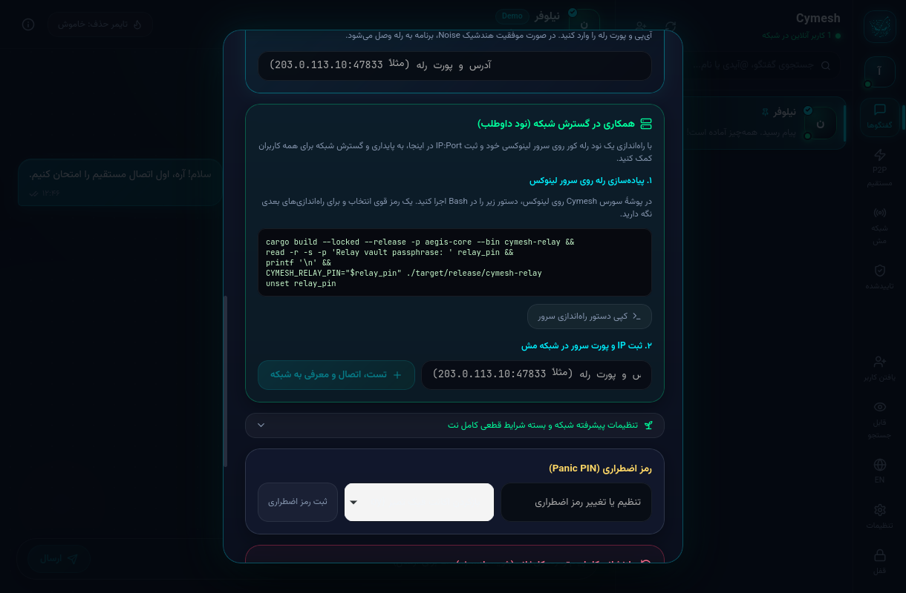

# راهنمای استفاده از سای‌مش

[صفحهٔ پروژه](../README.fa.md) · [English](user-guide.md)

این راهنما از داخل برنامه شروع می‌شود. برای ساخت پروفایل، پیدا کردن دوست و فرستادن پیام، کافی است برنامه را روی دو دستگاه باز کنید.

تصاویر از اجرای واقعی نسخهٔ عمومی روی لینوکس گرفته شده‌اند. نام‌ها و پیام‌ها نمونه‌اند. برای دیدن هر تصویر در اندازهٔ کامل، روی آن کلیک کنید.

## ۱. شروع کنید و اولین پیام را بفرستید

1. در صفحهٔ خوش‌آمد، گزینهٔ ساخت حساب را بزنید. یک نام نمایشی انتخاب کنید و رمزی بگذارید که برای باز کردن برنامه به آن نیاز دارید.
2. **۱۲ کلمهٔ بازیابی** را جایی امن و خصوصی نگه دارید. این کلمات به شما اجازه می‌دهند هویت قبلی‌تان را با گزینهٔ بازیابی برگردانید. گفتگوهای قبلی با این کلمات برنمی‌گردند.
3. برای اولین تجربه، هر دو دستگاه را به یک شبکهٔ محلی وصل کنید. برنامه را روی هر دو باز کنید و از نوار کنار، **یافتن کاربر** را بزنید. یکی از شما می‌تواند **کپی لینک دعوت** را بزند و لینک را برای دیگری بفرستد. کد QR دعوت یا شناسهٔ کامل مثل `@handle#TAG` هم قابل استفاده است.
4. گفتگو را باز کنید، پیام بنویسید و **ارسال** را بزنید. اگر مخاطب در جست‌وجو پیدا نشد، از لینک دعوت استفاده کنید. روی دو شبکهٔ جدا ممکن است نیاز به یک پل قابل‌دسترسی داشته باشید. [اتصال با پل](#connections)

<strong>تصاویر ساخت حساب، ورود و یافتن کاربر</strong>

## ۲. پروفایل را به سلیقهٔ خودتان تنظیم کنید

1. **تنظیمات → پروفایل کاربری** را باز کنید. می‌توانید از دکمهٔ تنظیمات یا لوگوی برنامه در نوار کناری وارد شوید.
2. **نام نمایشی** اسم شما در گفتگوهاست. **نام کاربری** بخش اول شناسهٔ جست‌وجوی شماست. اگر نام کاربری را عوض کردید، شناسهٔ کامل تازه را برای دوستانتان بفرستید.
3. در صورت دلخواه، عکس، رنگ تصویر، تگ پروفایل یا یک معرفی کوتاه اضافه کنید. برای تغییر یا برداشتن عکس از دکمه‌های همان بخش استفاده کنید. برنامه هنگام آماده‌سازی عکس، اطلاعات همراه فایل مثل مکان ثبت آن را حذف می‌کند. هر چیزی که در خود عکس دیده می‌شود، در عکس باقی می‌ماند.
4. **ذخیره پروفایل** را بزنید. برای دیدن شناسهٔ قابل‌اشتراک، دوباره **یافتن کاربر** را باز کنید.

<strong>تصویر تنظیمات پروفایل</strong>

## ۳. گفتگوها را مدیریت کنید

| کاری که می‌خواهید انجام دهید | از کجا انجامش دهید؟ |
| --- | --- |
| پاسخ دادن، واکنش ایموجی یا کپی متن | نشانگر را روی پیام ببرید و گزینهٔ مربوط را بزنید. |
| ویرایش یا حذف پیام خودتان | گزینه‌های کنار پیام را باز کنید. حذف محلی آن را از دستگاه شما برمی‌دارد. حذف دوطرفه درخواست حذف را به مخاطب می‌فرستد. |
| فرستادن پیام زمان‌دار | قبل از ارسال، دکمهٔ زمان‌سنج کنار کادر پیام را بزنید. گزینه‌ها خاموش، ۳۰ ثانیه، ۵ دقیقه و ۱ ساعت‌اند. مخاطب همچنان می‌تواند نسخه‌ای از پیام را کپی کند. |
| سنجاق کردن گفتگو یا تأیید مخاطب | روی نام مخاطب در بالای گفتگو بزنید تا پروفایلش باز شود. برای تأیید، کد امنیتی یا شش ایموجی را از طریق یک راه مطمئن با خود مخاطب مقایسه کنید. |
| تغییر زبان یا قفل‌کردن برنامه | دکمهٔ زبان یا قفل را در نوار کناری بزنید. در ویندوز `Ctrl+L` هم صندوق را قفل می‌کند. |

**در صف** یعنی پیام هنوز منتظر یک راه برای رسیدن به مخاطب است. **ارسال مستقیم** یا **ارسال از راه رله** مسیر پیام را نشان می‌دهد. **تحویل‌شده** یعنی برنامهٔ طرف مقابل دریافت را تأیید کرده و **خوانده‌شده** یعنی رسید خواندن برگشته است.

<strong>تصاویر گفتگو، ابزارهای پیام و پروفایل مخاطب</strong>

## ۴. حالت روح و تنظیمات حریم خصوصی

**حالت روح یا Ghost** وقتی به کار می‌آید که می‌خواهید افراد با جست‌وجوی نام کاربری شما را پیدا نکنند. از دکمهٔ حالت روح در نوار کناری استفاده کنید، یا در **تنظیمات → حریم خصوصی و موتور مش** آن را روشن کنید و **اعمال تنظیمات** را بزنید. برای شروع گفتگو با یک نفر، همچنان می‌توانید لینک دعوت را مستقیم برای او بفرستید. همتا یا رله ممکن است آدرس شبکهٔ اتصال را ببیند.

این گزینه‌ها هم در **حریم خصوصی و موتور مش** هستند. بعد از تغییرشان، **اعمال تنظیمات** را بزنید.

| نام گزینه | معنی ساده |
| --- | --- |
| **رله کور مش** | وقتی برنامه باز و از شبکه در دسترس است، دستگاه شما می‌تواند بسته‌های رمزگذاری‌شده را برای دیگران نگه دارد و بعداً بفرستد. |
| **دفترچه آیدی غیرمتمرکز** | برنامه از دستگاه‌هایی که به آن‌ها دسترسی دارد برای پیدا کردن حساب‌ها کمک می‌گیرد. |
| **عبور خودکار از NAT و تونل مستقیم** | برنامه تلاش می‌کند حتی وقتی دستگاه‌ها پشت مودم‌های جدا هستند، بینشان مسیر مستقیم پیدا کند. موفقیت به شبکه بستگی دارد. |
| **رله پیازی چندلایه** | برنامه می‌تواند اطلاعات مسیر را در چند لایه بپیچد و از چند رله عبور دهد، اگر مسیر مناسب در دسترس باشد. |
| **بررسی اختیاری کشور آی‌پی** | پیش‌فرض خاموش است. با روشن کردنش، سرویس‌های بیرونی آی‌پی شما را برای تشخیص کشور می‌بینند و برنامه می‌تواند دسترسی از آی‌پی خارج از ایران را مسدود کند. بررسی VPN و پروکسی جداگانه است. |

<strong>تصویر حالت روح و حریم خصوصی</strong>

## ۵. تنظیمات اتصال و کمک به شبکه

- **افزودن پل** برای وقتی است که می‌خواهید برنامهٔ خودتان از یک ورودی مشخص به شبکه وصل شود. در **تنظیمات پیشرفته شبکه** نشانی مورد اعتماد یا لینک را وارد کنید. همان‌جا می‌توانید بستهٔ `CYMESH-SEED` را وارد یا کپی کنید. این بسته فهرستی از نشانی‌های اتصال است و می‌تواند آدرس شبکه داشته باشد.
- **بررسی اتصال به رله** را وقتی بزنید که می‌خواهید بدانید برنامه از شبکهٔ فعلی به یک نشانی مشخص وصل می‌شود یا نه. **وضعیت زنده شبکه مش** تعداد همتاهای متصل و بسته‌های منتظر را نشان می‌دهد.
- **همکاری در گسترش شبکه** برای زمانی است که یک رلهٔ فعال دارید و می‌خواهید از داخل همین برنامه آن را به همتاهای متصل معرفی کنید. [راهنمای داوطلب‌ها](../README.fa.md#grow-the-mesh)
- **ساخت نسخهٔ سفارشی** برای برنامه‌نویسی است که می‌خواهد یک فایل نصب ویندوز با نشانی رلهٔ ازپیش‌تنظیم‌شده در اختیار گروهش بگذارد. [راهنمای بیلدر](../README.fa.md#relay-builder)

<strong>تصاویر افزودن پل و بخش داوطلب</strong>

## ۶. رمز اضطراری، میان‌بر ویندوز و بازنشانی

این سه گزینه پایین‌تر در همان صفحهٔ **تنظیمات** هستند. برای تنظیم رمز اضطراری، در بخش **رمز اضطراری** نوع عملکرد را انتخاب کنید و **ثبت رمز اضطراری** را بزنید.

| گزینه | قبل از استفاده بدانید |
| --- | --- |
| **رمز اضطراری (Panic PIN)** | یک رمز جدا از رمز عادی است. گزینهٔ حساب نمایشی صندوق دیگری را باز می‌کند. گزینهٔ امحا با وارد کردن رمز اضطراری صندوق اصلی را حذف می‌کند. برای استفادهٔ عادی کافی است همان رمز معمولی را داشته باشید. |
| **ساخت میانبر دسکتاپ و استارت** | در ویندوز، برنامه را در پوشهٔ کاربر کپی می‌کند و میان‌بر می‌سازد. برای اجرای راحت‌تر نسخهٔ قابل‌حمل به کار می‌آید. |
| **بازنشانی کامل** | پیام‌ها، مخاطبان و کلیدهای صندوق را از همین دستگاه حذف می‌کند. پیش از تأیید، مطمئن شوید به داده‌های محلی نیاز ندارید. ۱۲ کلمه فقط هویت را بازیابی می‌کند. |

