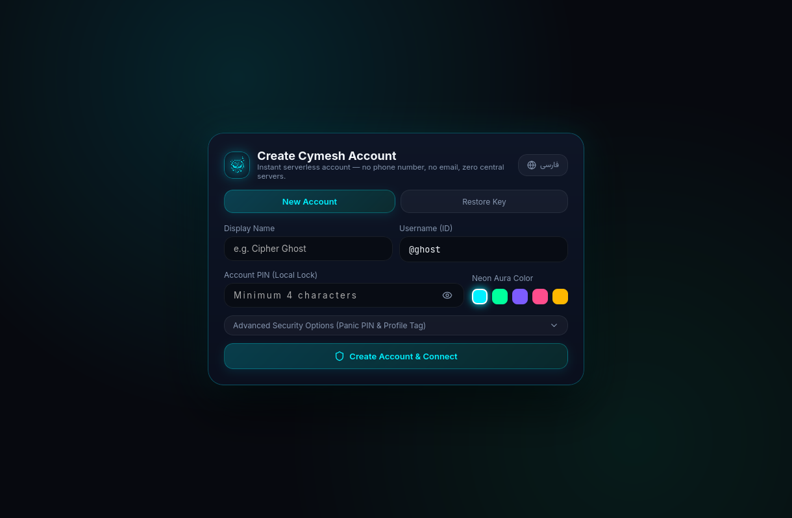
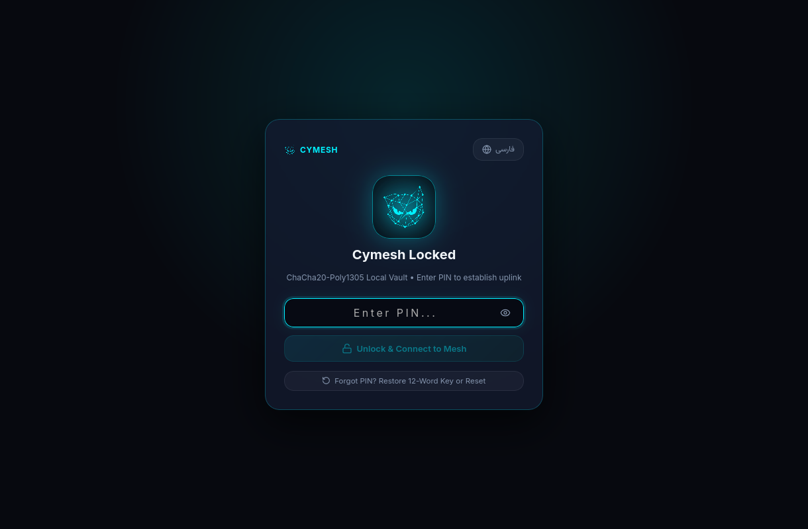
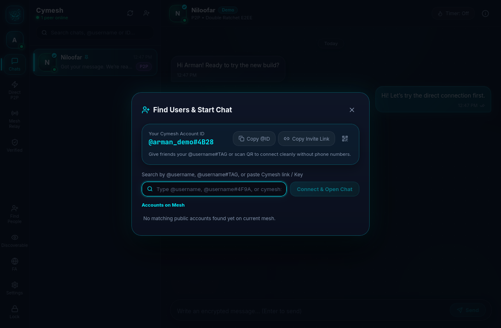
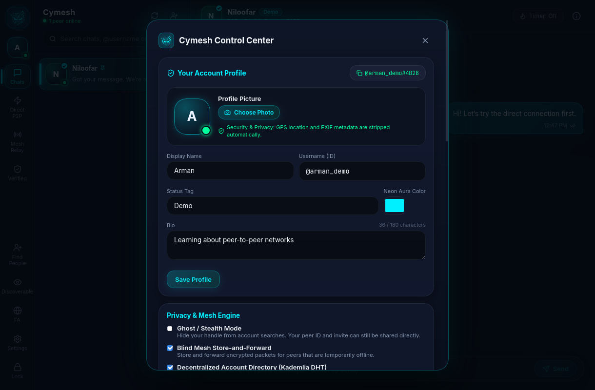
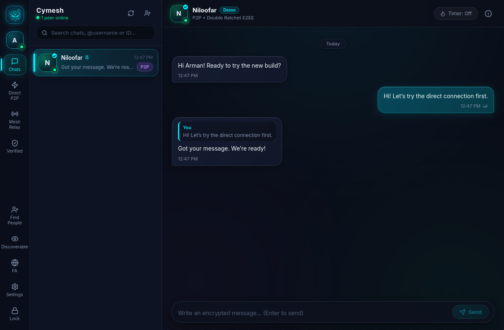
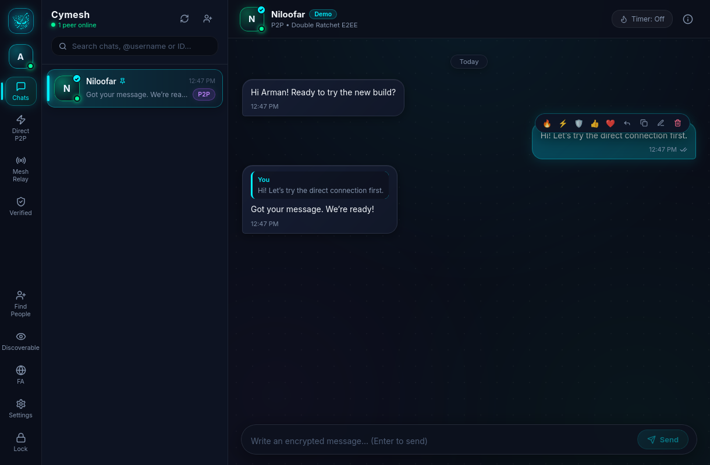
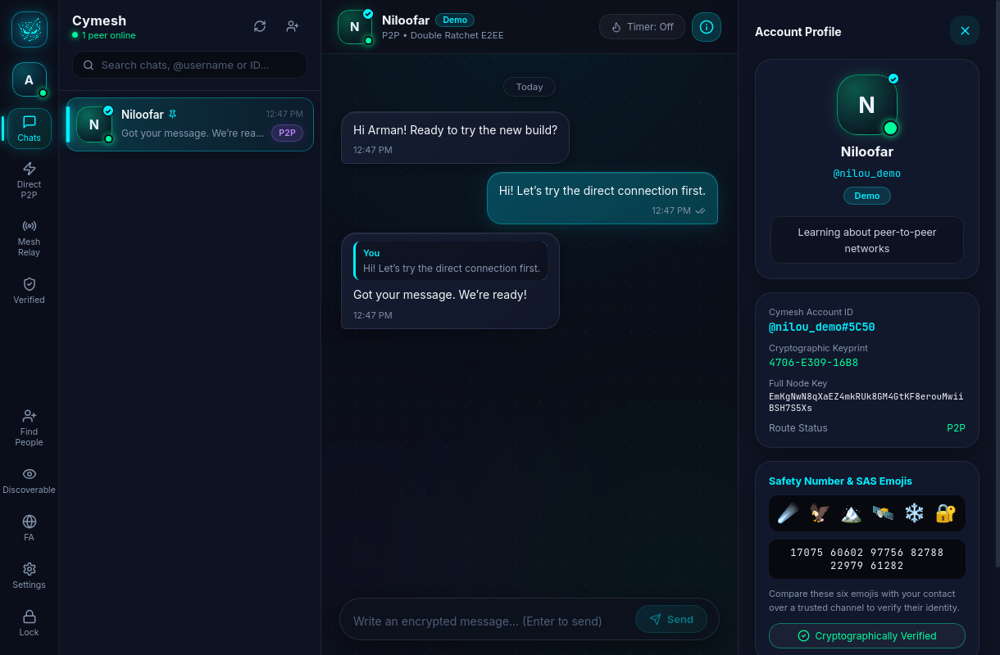
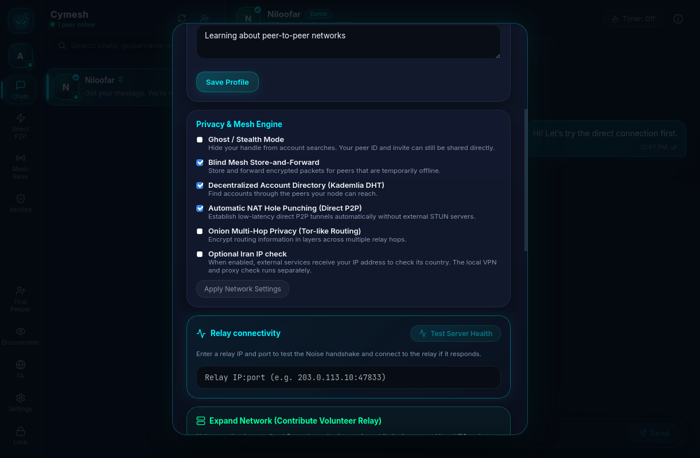
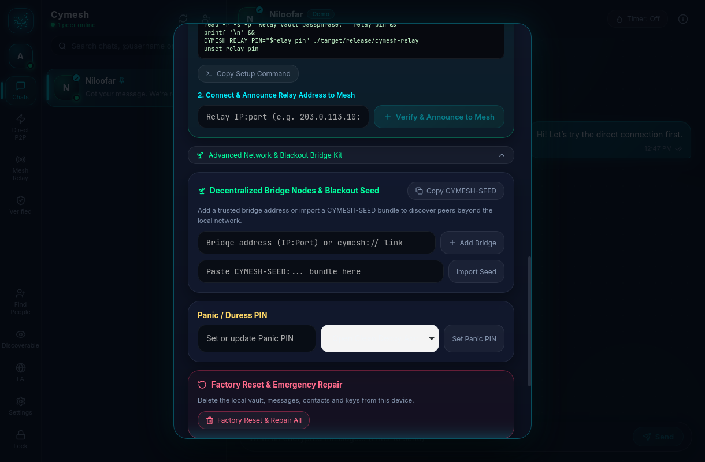
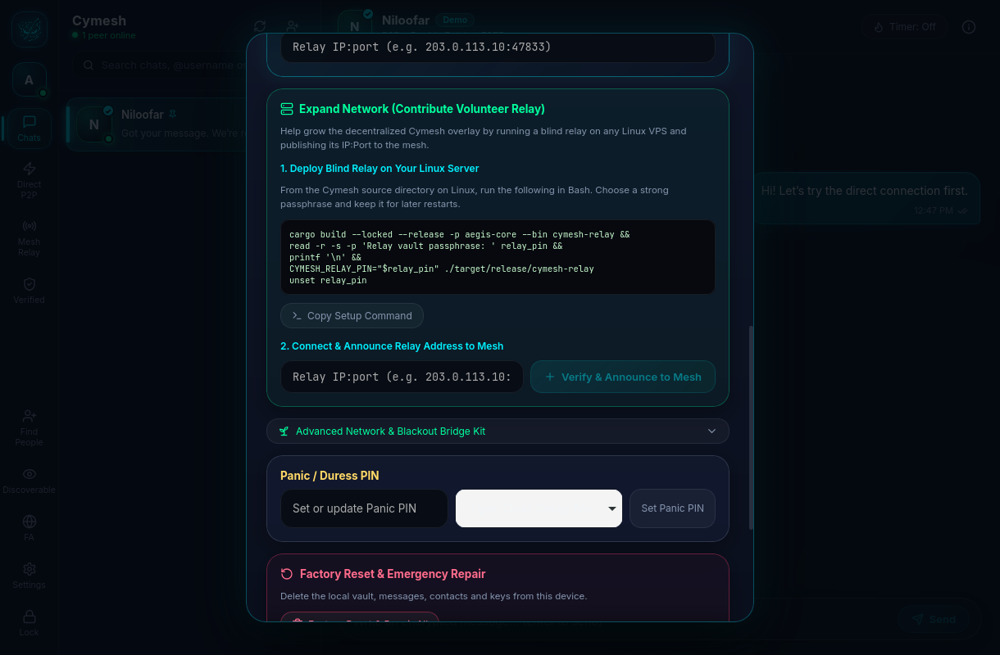

# Using CyMesh

[Project home](../README.md) · [فارسی](user-guide.fa.md)

This guide starts inside the app. Open CyMesh on two devices to set up a profile, find a friend and send a first message.

Screenshots show the public app running on Linux with sample names and messages. Click an image to open it at full size.

## 1. Send a first message

1. Choose **New Account** on the welcome screen. Pick a display name and set a PIN that you will use to open the app.
   

2. Keep the **12 recovery words** somewhere safe and private. You can use **Restore Key** to recover your identity. Your old chats are stored on the original device and do not come back with the phrase.
   

3. To try it for the first time, put both devices on the same local network. Unlock both apps and open **Find People** from the sidebar. Use **Copy Invite Link** and send it to your friend. You can also share the invite QR code or a full ID such as `@handle#TAG`.
   

4. Open the chat, type a message and press **Send**. Try the invite link if search finds no match. Across networks, you may need a reachable bridge. [Connect through a bridge](#connections)

## 2. Make your profile yours

1. Open **Settings → Your Account Profile**. The settings button or app logo in the sidebar opens Settings.
2. Your **Display Name** appears in conversations. Your **Username** is the first part of the ID people can search for. Share your updated full ID if you change the username.
3. You can choose a photo, avatar color and status tag, and write a short bio. Use the photo buttons to change or remove it. CyMesh strips embedded details such as the location where a photo was taken. Information visible in the picture itself stays visible.
4. Click **Save Profile**. To check the ID you can share, open **Find People** again.

## 3. Use the chat controls

Choose **Chats** in the sidebar to see all your contacts. If you spoke to Niloofar yesterday, type her name above the chat list and select the conversation. If you’re looking for her for the first time, open **Find People**. **Direct P2P** shows just conversations with a direct route. If a familiar name disappears, go back to **Chats** and clear the search box.

Press `Enter` to send. For a new line in the same message, press `Shift+Enter`.

### Reply to a particular message

Three messages come in while you’re typing. To answer the first question, hover over that message and choose **Reply**. The composer shows which message you picked. For a quick acknowledgment, choose an emoji reaction on the message instead.

| I want to… | What to do |
| --- | --- |
| Reply, react with emoji or copy text | Move over a message and choose a control beside it. |
| Edit or delete my message | Open the controls beside your own message. **Delete locally** removes it from your device. **Delete for both** sends a deletion request to the other app. |
| Send a message that expires | Before sending, use the timer beside the message box. It cycles through off, 30 seconds, 5 minutes and 1 hour. Someone can still keep a copy of the message. |
| Pin a chat or verify a contact | Open their profile by clicking the name above the chat. To verify, compare the safety number or six emojis directly with the person through a channel you trust. |
| Switch language or lock the app | Use the language or lock button in the sidebar. On Windows, `Ctrl+L` also locks the vault. |

**Queued** means the message is waiting for a route. **Sent direct** or **Routed in Mesh** tells you the path used. **Delivered** means the other app confirmed receipt. **Read** means it sent a read receipt.

### Is this really Niloofar?

Click her name above the conversation. Call her on a number you already know and read each other the six emojis in order. If they match, mark the contact as verified. You can now find this conversation under **Verified** in the sidebar.

## 4. Ghost Mode and privacy settings

**Ghost / Stealth Mode** hides your username from account searches. Toggle it from the sidebar, or open **Settings → Privacy & Mesh Engine**, switch it on and click **Apply Network Settings**. You can still send an invite link directly to someone. Peers or relays may see the network address used for a connection.

These controls are also under **Privacy & Mesh Engine**. Click **Apply Network Settings** after changing them.

| Control | What it does in plain terms |
| --- | --- |
| **Blind Mesh Store-and-Forward** | While the app is unlocked and reachable, it can hold encrypted packets for other people and forward them later. |
| **Decentralized Account Directory** | The app asks other reachable devices to help find an account. |
| **Automatic NAT Hole Punching** | The app tries to find a direct path between devices on different routers. Success depends on the networks. |
| **Onion Multi-Hop Privacy** | If suitable relays are available, the app can wrap routing information in layers and pass it through several relays. |
| **Optional Iran IP check** | Off by default. With it on, external services see your IP to look up its country, and the app can block access from outside Iran. The VPN and proxy check is separate. |

## 5. Connect to a network or help it grow

- **Add Bridge** gives your copy of CyMesh a known way into a network. In **Advanced Network & Blackout Bridge Kit**, enter an address or invite you trust. You can also import or copy a `CYMESH-SEED` bundle there. A bundle is a list of connection addresses and can contain network details.

- **Relay connectivity** lets you check whether your app can reach a specific relay. **Live Mesh Diagnostics** shows how many peers are connected and how many packets are waiting.
- **Contribute Volunteer Relay** is for someone with a running relay who wants to announce it to peers from the current app. [Volunteer guide](../README.md#grow-the-mesh)

- **Custom Windows build** is for developers who want to give a group a Windows app with its relay address filled in. [Builder guide](../README.md#relay-builder)

### My message is still queued. What should I check?

1. If you’re in the same room, unlock both apps and check that both devices are on the same local network. Some guest Wi-Fi networks isolate devices from each other.
2. If you’re on different networks and use a bridge, test its address under **Relay connectivity**. A successful handshake means your device reached the relay. Look for **Delivered** in the conversation to tell whether Niloofar’s app received the message.
3. Under **Live Mesh Diagnostics**, look at the connected peer count. Zero means your app has no peers connected right now. Once your contact or relay is reachable, check the status of the original message again.

## 6. Duress PIN, Windows shortcuts and reset

Look further down the **Settings** screen for these controls. To configure a duress PIN, choose its mode under **Panic / Duress PIN** and click **Set Panic PIN**.

| Setting | What to know before using it |
| --- | --- |
| **Panic / Duress PIN** | A separate PIN with two modes. The decoy mode opens a separate vault. The wipe mode deletes the main vault when the duress PIN is entered. The normal PIN is enough for everyday use. |
| **Create Desktop & Start Menu Shortcuts** | On Windows, this copies the app into the user’s folder and creates shortcuts. It is handy when using the portable app. |
| **Factory Reset** | This removes messages, contacts and vault keys on this device. Before confirming, make sure you no longer need the local data. The 12 words restore your identity only. |
